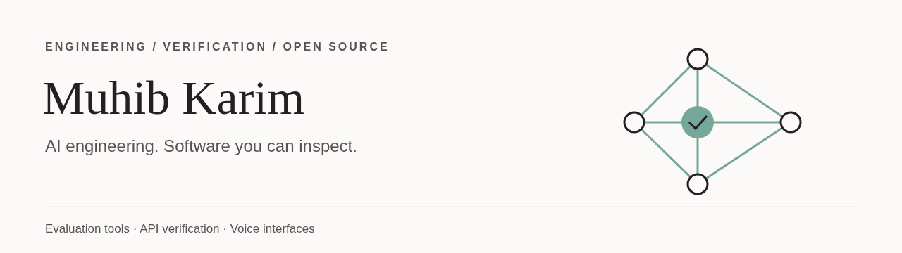

  

# muhib-karim

I work on AI engineering and software verification and validation (V&V). I came to software through automotive test engineering, so I build tools the way I was trained to test: written requirements, repeatable checks and evidence someone else can inspect.

Open to AI engineering and V&V roles in Australia.

## Projects

- **[agent-eval-harness](https://github.com/muhib-karim/agent-eval-harness)**: compares coding models and agent CLIs on the same tasks, with hidden pytest grading, unbiased pass@k and JSONL evidence with SHA-256 provenance. [Site](https://muhib-karim.github.io/agent-eval-harness/) 
- **[api-vv-toolkit](https://github.com/muhib-karim/api-vv-toolkit)**: generates API tests from an OpenAPI 3.x spec and written requirements, runs them and reports a requirements traceability matrix with a CI exit-code gate. [Site](https://muhib-karim.github.io/api-vv-toolkit/) 
- **[codegraph](https://github.com/muhib-karim/codegraph)**: indexes Python and Java into an embedded code graph and answers callers, inheritance, dead-code and change-impact queries with file:line evidence. [Site](https://muhib-karim.github.io/codegraph/) 
- **[bangla-llm-eval](https://github.com/muhib-karim/bangla-llm-eval)**: a small, reproducible Bangla (Bengali) evaluation of LLMs: translation, NLI and Bengali numerals, with raw outputs and a live leaderboard. [Site](https://muhib-karim.github.io/bangla-llm-eval/) 
- **[humming-keyboard](https://github.com/muhib-karim/humming-keyboard)**: private keyboard with offline voice typing: a FlorisBoard-based Android keyboard plus iPhone, Windows, macOS and Linux apps; Bangla phonetic typing. [Site](https://muhib-karim.github.io/humming-keyboard/) 
- **[code-video-kit](https://github.com/muhib-karim/code-video-kit)**: 34 typed Remotion components for code and data videos, with a rendered gallery and measured render times. [Site](https://muhib-karim.github.io/code-video-kit/) 
- **[Rambler-Bangla](https://github.com/muhib-karim/Rambler-Bangla)**: Bengali-first voice typing for Gboard 18.3.1: a fail-closed, fingerprint-guarded smali patcher plus a Java policy runtime, with a device-free CI suite that builds, patches and verifies a synthetic APK. Source only, no APKs. [Site](https://muhib-karim.github.io/Rambler-Bangla/) 

## Extended open source

- **[sonu](https://github.com/muhib-karim/sonu)**: private, offline voice typing for Windows, macOS and Linux, transcribing into any app with local Parakeet/Whisper/Moonshine models; an independent fork of [Handy](https://github.com/cjpais/Handy). [Site](https://muhib-karim.github.io/sonu/) 
- **[Antigravity-Claude-Code-Proxy](https://github.com/muhib-karim/Antigravity-Claude-Code-Proxy)**: local Anthropic API gateway so Claude Code can use Gemini, Claude (via Google Cloud Code) and Perplexity; extends [antigravity-claude-proxy](https://github.com/badrisnarayanan/antigravity-claude-proxy). [Site](https://muhib-karim.github.io/Antigravity-Claude-Code-Proxy/) 

## Developer tools and AI agents

- **[OpenSH](https://github.com/muhib-karim/OpenSH)**: natural-language shell: plain English in, one PowerShell/Bash/Zsh command out, with a safety guard that holds destructive commands for confirmation. Single-file, stdlib-only Python CLI. [Site](https://opensh.vercel.app) 
- **[NewTerminal-AI](https://github.com/muhib-karim/NewTerminal-AI)**: PowerShell module that turns plain-English requests into commands with a local Ollama model, behind an AST-based destructive-command gate; Pester-tested on Ubuntu and Windows. 
- **[opencode-superapp](https://github.com/muhib-karim/opencode-superapp)**: schema-validated registry of 50 MCP servers and 7 one-command stacks for the OpenCode agent, with a zero-dependency installer that merges configs safely and never writes secrets. 
- **[antigravity-workflow-kit](https://github.com/muhib-karim/antigravity-workflow-kit)**: VS Code extension for the Antigravity editor: auto-accepts AI edits over the Chrome DevTools Protocol, with a banned-command deny-list and a loop guarded by a circuit breaker and rate limiter. [Open VSX](https://open-vsx.org/extension/ai-dev-2024/antigravity-workflow-kit) 
- **[Claude-Proxy-Extension](https://github.com/muhib-karim/Claude-Proxy-Extension)**: VS Code extension for a local Claude/Gemini proxy: per-window model switching, live per-account quota bars and a status-bar proxy toggle. [Open VSX](https://open-vsx.org/extension/ai-dev-2024/claude-proxy-status) 
- **[bounty-radar](https://github.com/muhib-karim/bounty-radar)**: daily sweep of live, payable open-source bounties with repo-liveness checks and spam filtering; publishes HTML/RSS/JSON, an MCP server and a Worker API. [Site](https://muhib-karim.github.io/bounty-radar/) 
- **[google-takeout-metadata-fixer](https://github.com/muhib-karim/google-takeout-metadata-fixer)**: Python CLI that restores EXIF dates, GPS, descriptions and people tags to Google Photos Takeout exports by matching JSON sidecars and writing them with ExifTool. 

## Apps

- **[openclaw-desktop](https://github.com/muhib-karim/openclaw-desktop)**: Tauri 2 + Rust + React desktop app for the OpenClaw assistant: installs the CLI, runs and monitors the local gateway, embeds its dashboard, streams logs and runs diagnostics. 
- **[codex-manager](https://github.com/muhib-karim/codex-manager)**: prototype Tauri v2 desktop app for managing several OpenAI API accounts: encrypted local storage, usage tracking and a local OpenAI-compatible proxy with 4 routing strategies. 
- **[VoiceDicatationCodex](https://github.com/muhib-karim/VoiceDicatationCodex)**: offline voice dictation for Windows: a .NET 8 WPF app that downloads SHA-256-verified whisper.cpp models and transcribes locally, no cloud API. 
- **[vehicle-selector-pro](https://github.com/muhib-karim/vehicle-selector-pro)**: multi-tenant Shopify app (Rails 7.2) for automotive stores: Year/Make/Model/Trim/Engine fitment, a cascading storefront selector, fit badges and OE-number search. [Report](https://muhib-karim.github.io/vehicle-selector-pro/) 
- **[voip-saas-platform](https://github.com/muhib-karim/voip-saas-platform)**: full-stack VoIP SaaS reference: Express API with JWT auth, signed call-control webhooks, an atomic prepaid wallet and call records; React softphone and Expo app, 200 backend tests on Postgres. 
- **[HoliBooks](https://github.com/muhib-karim/HoliBooks)**: browser reader for the Quran, Bible, Bhagavad Gita, Torah, Guru Granth Sahib and Dhammapada: a vanilla JS PWA on public scripture APIs, with bookmarks, search and audio. [Site](https://holibooks.vercel.app) 
- **[markdown-resume-micro](https://github.com/muhib-karim/markdown-resume-micro)**: client-side Markdown resume builder: live preview, 3 print-ready themes, PDF via the browser and an offline CLI. Zero dependencies, no tracking. [Site](https://muhib-karim.github.io/markdown-resume-micro/) 

## How I work

- **Written requirements:** tests start from them, and results are reported in a traceability matrix.
- **Independent checks:** hidden pytest grading, a labelled retrieval evaluation, a spec validation gate.
- **Raw evidence kept:** JSONL with SHA-256 provenance, raw model outputs, file:line references.
- **CI:** runs on every repo that shows a badge here; each badge links to its workflow runs.

**Built with:** Python (pytest, pydantic, httpx), TypeScript (React, Remotion, zod), JavaScript (Node.js, Express), Rust (Tauri), Kotlin (Jetpack Compose), SwiftUI, C# (.NET, WPF), Ruby on Rails, PowerShell, tree-sitter, sherpa-onnx, MCP, GitHub Actions.
