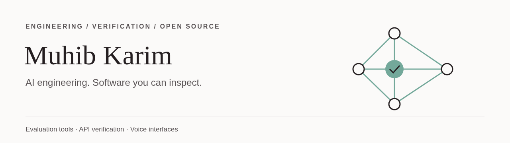

  

# Muhib Karim

AI engineer · Software verification & validation · Australia

I came to software through automotive test engineering, so I build tools the way I was trained to test: written requirements, repeatable checks and evidence someone else can inspect. Most of my recent work is in AI evaluation, API verification, LLM tooling and offline voice input.

## Featured projects

| Project | What it does | Stack | Links |
| --- | --- | --- | --- |
| [**Humming**](https://github.com/muhib-karim/humming-keyboard) | Offline voice keyboard with Bangla: talk and it types, on your device, with no account and no analytics. Android keyboard plus iPhone, Windows, macOS and Linux apps. Latest release [v1.7.0](https://github.com/muhib-karim/humming-keyboard/releases/tag/v1.7.0). | Kotlin · sherpa-onnx · NVIDIA Parakeet | [code](https://github.com/muhib-karim/humming-keyboard) · [live](https://muhib-karim.github.io/humming-keyboard/) |
| [**agent-eval-harness**](https://github.com/muhib-karim/agent-eval-harness) | Compares coding models and agent CLIs on the same tasks, graded by withheld pytest suites; unbiased pass@k with JSONL evidence. Measured run of 108 live attempts across 6 models (17 Oct 2026), every attempt committed. | Python · asyncio · Pydantic · pytest | [code](https://github.com/muhib-karim/agent-eval-harness) · [live](https://muhib-karim.github.io/agent-eval-harness/)  |
| [**api-vv-toolkit**](https://github.com/muhib-karim/api-vv-toolkit) | Turns OpenAPI contracts and written requirements into executed API tests and a requirements traceability matrix (HTML/CSV/JUnit). 129 tests, 98% coverage. | Python · httpx · jsonschema · pytest | [code](https://github.com/muhib-karim/api-vv-toolkit) · [live](https://muhib-karim.github.io/api-vv-toolkit/)  |
| [**sonu**](https://github.com/muhib-karim/sonu) | Offline voice typing for the desktop: local Whisper, Parakeet and Moonshine models, types into any app. Tauri v2 build for Windows, macOS and Linux. | Rust · Tauri v2 · React · TypeScript | [code](https://github.com/muhib-karim/sonu) · [live](https://muhib-karim.github.io/sonu/)  |
| [**Antigravity-Claude-Code-Proxy**](https://github.com/muhib-karim/Antigravity-Claude-Code-Proxy) | Local Anthropic-compatible gateway so Claude Code can run on other providers: stream and tool-call translation, account rotation, per-session routing. Extends an MIT-licensed upstream. | Node.js · Express · node:test | [code](https://github.com/muhib-karim/Antigravity-Claude-Code-Proxy) · [live](https://muhib-karim.github.io/Antigravity-Claude-Code-Proxy/)  |
| [**Rambler-Bangla**](https://github.com/muhib-karim/Rambler-Bangla) | Fail-closed patch layer that keeps Bengali dictation in Bengali script in Gboard 18.3.1, with a device-free CI pipeline that builds, patches and validates a synthetic APK. | Python · Java · smali · Android tooling | [code](https://github.com/muhib-karim/Rambler-Bangla) · [live](https://muhib-karim.github.io/Rambler-Bangla/)  |
| [**vehicle-selector-pro**](https://github.com/muhib-karim/vehicle-selector-pro) | Year/Make/Model fitment app for Shopify stores: HMAC-verified App Proxy, Sidekiq metafield sync, webhooks and billing. 109 RSpec examples. | Ruby on Rails 7.2 · Sidekiq · PostgreSQL | [code](https://github.com/muhib-karim/vehicle-selector-pro) · [live](https://muhib-karim.github.io/vehicle-selector-pro/)  |
| [**Sitara**](https://github.com/muhib-karim/sitara) *(in progress)* | Open-source YouTube Music client for Android. The interface is being rebuilt from the ground up; screenshots will follow once the new version is ready. | Kotlin · Jetpack Compose · Media3 | [code](https://github.com/muhib-karim/sitara) |

## More projects

| Project | What it does | Stack | Links |
| --- | --- | --- | --- |
| [OpenSH](https://github.com/muhib-karim/OpenSH) | Talk to your terminal in plain English | Python 3 · Groq API · Google Gemini API | [code](https://github.com/muhib-karim/OpenSH) · [live](https://opensh.vercel.app) |
| [bounty-radar](https://github.com/muhib-karim/bounty-radar) | Sweep, verify and rank open-source bounties, jobs and challenges | JavaScript · node:test · GitHub CLI | [code](https://github.com/muhib-karim/bounty-radar) · [live](https://muhib-karim.github.io/bounty-radar/) |
| [google-takeout-metadata-fixer](https://github.com/muhib-karim/google-takeout-metadata-fixer) | Restore dates, GPS, descriptions and people tags from Google Takeout JSON sidecars | Python 3.9+ · ExifTool · ADB | [code](https://github.com/muhib-karim/google-takeout-metadata-fixer) |
| [codex-manager](https://github.com/muhib-karim/codex-manager) | Multi-account OpenAI API manager with smart routing | Rust · Tauri v2 · Axum | [code](https://github.com/muhib-karim/codex-manager) |
| [openclaw-desktop](https://github.com/muhib-karim/openclaw-desktop) | Desktop control panel for the OpenClaw AI gateway | Rust · Tauri 2 · React 19 | [code](https://github.com/muhib-karim/openclaw-desktop) |
| [voip-saas-platform](https://github.com/muhib-karim/voip-saas-platform) | Browser softphone, phone numbers & prepaid billing | JavaScript · Express · Knex | [code](https://github.com/muhib-karim/voip-saas-platform) |
| [NewTerminal-AI](https://github.com/muhib-karim/NewTerminal-AI) | Plain English in, PowerShell out, powered by local Ollama models | PowerShell 7 · Ollama REST API · Pester 5 | [code](https://github.com/muhib-karim/NewTerminal-AI) |
| [opencode-superapp](https://github.com/muhib-karim/opencode-superapp) | Curated MCP servers and one-command stacks for OpenCode | JavaScript · JSON Schema · node:test | [code](https://github.com/muhib-karim/opencode-superapp) |
| [antigravity-workflow-kit](https://github.com/muhib-karim/antigravity-workflow-kit) | Auto-accept, autonomous loops and safety rails for the Antigravity IDE | TypeScript · JavaScript · VS Code Extension API | [code](https://github.com/muhib-karim/antigravity-workflow-kit) |
| [Claude-Proxy-Extension](https://github.com/muhib-karim/Claude-Proxy-Extension) | Per-window model switching and live quota monitoring for a local Claude / Gemini proxy, right in the VS Code status bar | JavaScript · VS Code Extension API · node:test | [code](https://github.com/muhib-karim/Claude-Proxy-Extension) |
| [VoiceDicatationCodex](https://github.com/muhib-karim/VoiceDicatationCodex) | Offline voice dictation for Windows with local Whisper models | C# · .NET 8 · WPF | [code](https://github.com/muhib-karim/VoiceDicatationCodex) |
| [markdown-resume-micro](https://github.com/muhib-karim/markdown-resume-micro) | Write your resume in Markdown. Print it as a PDF | JavaScript · HTML · CSS | [code](https://github.com/muhib-karim/markdown-resume-micro) · [live](https://muhib-karim.github.io/markdown-resume-micro/) |
| [HoliBooks](https://github.com/muhib-karim/HoliBooks) | Six sacred texts. One distraction-free reader | JavaScript · HTML5 · CSS3 | [code](https://github.com/muhib-karim/HoliBooks) |

Every repository above has a README with setup steps, a test suite and GitHub Actions CI. Demos and seeded examples show how each tool behaves; they are not benchmarks of live services. Each README states what was and was not verified.

## Engineering focus

- **AI evaluation:** repeatable tasks, withheld tests, pass@k and inspectable result records.
- **Verification & validation:** OpenAPI contracts, requirements traceability and clear failure reports.
- **Developer tooling:** LLM gateways, editor extensions and natural-language shells with safety guards.
- **Voice interfaces:** local speech-to-text on desktop and Android.

## How to review a project

Open its README, run the documented example, then read the tests and the CI run. CI badges show the checks each project configures; they don't replace testing in your own environment.
